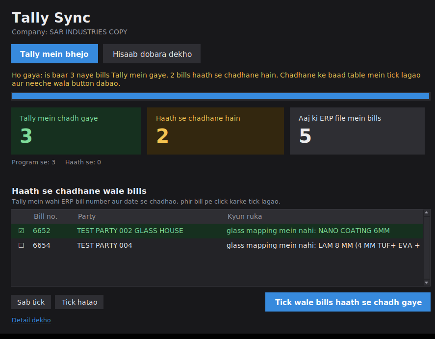
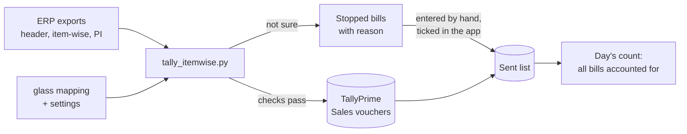

# ERP → Tally Sync

**Automatic sales-bill entry from a glass factory's ERP into TallyPrime, so accounts stop typing every bill twice.**



*The Tally Sync window for accounts (dummy data). Green: bills already in Tally. Amber: bills the program stopped on, to be entered by hand. Tick them once entered, and the day's count is complete.*

---

## The problem

Accounts typed every sales bill twice: once in the ERP (esyGlass / RecEmsPro), and again in TallyPrime, about two hours a day, with the usual typing mistakes (a voucher number entered twice, a wrong item, a wrong total). The ERP is a packaged product sold to many companies, so it could not be changed.

## The solution

A small Python program reads the ERP's own exports and creates the same bills in TallyPrime through Tally's XML interface (port 9000). Nothing in the ERP is touched. Anything the program is not sure about, it **does not guess**: it stops that one bill, explains why in plain Hindi, and leaves it for accounts to enter by hand.



## Features

- **Item invoices, exactly like accounts make them:** one stock line per product and glass type, quantity in SQM from the ERP area, hole / cutout / freight / document charge as separate ledger lines, CGST + SGST or IGST, round off.
- **Real Tally numbering:** voucher numbers like `SAR/7301/26-27`; the financial-year part comes from the bill date and changes by itself every April.
- **Right sales ledger by itself:** local bills go to the local sales ledger, other-state bills to the IGST ledger; only 18% GST bills are sent.
- **Glass name mapping:** 255 ERP glass names mapped to Tally stock items, checked line by line with accounts. Unmapped glass stops the bill instead of picking a wrong item (a wrong item means wrong stock and a wrong HSN in the GST return).
- **GST-ready bills:** party state, registration type and place of supply are read from Tally and written into every bill, so GSTR-1 shows them as "Included", not "Uncertain".
- **One-click app for accounts:** a dark, simple window with one main button, a table of stopped bills with the reason, and tick boxes for bills entered by hand. No commands, no copy-paste.
- **The day's count:** every bill of the ERP file is either sent by the program, entered by hand, or listed as still waiting, so nothing is silently missed.

## Safety first

The program is built so that a mistake stops a bill instead of reaching the books.

| Risk | What the program does |
|---|---|
| Same bill sent twice | A sent list remembers every bill; before sending, Tally is also asked which voucher numbers already exist, and those are never sent again |
| Bill typed by hand and also by the program | Hand-entered bills are ticked in the app (or `--mark-manual`) and never sent; the duplicate check catches the rest |
| Old bills already in a restored company | `start_from_invoice`: live mode refuses to send while it is not set |
| Wrong item or unknown glass | The bill stops with the reason; nothing is guessed |
| Totals do not match the ERP | Amounts are never recomputed; the bill must balance to the ERP's assessable value and net amount, round off under Rs 1 |
| ERP bill changed after it reached Tally | Reported as CHANGED; Tally is never altered by the program |
| Tally closed or wrong company | The run stops at once with a clear message; nothing is marked as sent |
| Two copies running together | An operating-system lock lets only one copy run at a time |
| Testing on real data | Dummy-only options (test date, auto-created parties, fallback item) are refused in live mode |

Rollout plan: dummy company → GST test company → one week side by side in a **copy** of the real company (accounts keep typing in the real one) → go-live only with written approval and a fresh backup.

## Files

| File | What it does |
|---|---|
| `tally_itemwise.py` | The main program: reads exports, builds and checks bills, posts them to Tally |
| `tally_sync_app.py` | The app window for accounts (runs `tally_itemwise.py` underneath) |
| `Tally_Sync_App.bat` | Opens the app window |
| `Tally_Sync.bat` | The same thing in a console window (backup way) |
| `check_parties.py` | Read-only: does every ERP customer have a ledger in Tally? |
| `check_items.py` | Read-only: does every mapped stock item exist in Tally, with the right unit? |
| `Accept_Change.bat`, `accept_change.py` | After a CHANGED bill was corrected in Tally by hand |
| `Forget_Bill.bat`, `forget_bill.py` | Send a bill again after deleting it in Tally |
| `settings.ini` | Company, ledger names, file names, safety switches (no code change for live) |
| `glass_mapping_*.csv` | ERP glass name → Tally stock item |
| `party_mapping.csv` | ERP customer name → Tally ledger name, where they differ |

## Setup

1. Install **Python 3.14** (tick "Add python.exe to PATH"; keep tcl/tk on).
2. `pip install requests pandas xlrd openpyxl`
3. In TallyPrime: enable the XML server on port 9000 (Connectivity), load the company.
4. Fill `settings.ini`: company, ledgers, ERP export file names, `start_from_invoice`.
5. Read-only checks first:
   ```
   python check_parties.py
   python check_items.py
   python tally_itemwise.py --dry-run
   ```

## Daily use

1. Export the three ERP reports (Invoice Register gross, item wise, PI report) with the fixed file names.
2. Double-click **Tally_Sync_App.bat** → **Tally mein bhejo**.
3. Enter the stopped bills in Tally by hand (same ERP number and date), tick them → **Tick wale bills haath se chadh gaye**.
4. The count shows "Sab bills Tally mein hain".

## Useful commands

```
python tally_itemwise.py --dry-run               # check everything, send nothing
python tally_itemwise.py --only 7351             # send one bill
python tally_itemwise.py --show 7351             # print the XML of one bill
python tally_itemwise.py --mark-manual 7352 7360 # bills entered by hand
python tally_itemwise.py --settings other.ini    # another company / settings file
```

## What I learned

- Tally's XML import is strict in small ways: `LEDGERENTRIES.LIST` (not `ALLLEDGERENTRIES.LIST`) for item invoices, `ISDEEMEDPOSITIVE` = Yes only for the party line, or a minus round off turns into a plus.
- A bill can be created in Tally and still be "Uncertain" in GSTR-1: the company GSTIN, the unit's UQC and the party details inside the bill all have to be there.
- The most reliable debugging method: make the same bill by hand in Tally, export it as XML, and compare it with what the program sent.
- The hardest part was not code but data: the same glass written ten ways in the ERP, and settling with accounts which Tally item each one belongs to.

## Roadmap

- Read bills straight from the ERP database (read-only copy) instead of daily exports
- An unattended scheduled run
- A one-page Hindi guide next to the accounts PC

## Tech

Python 3 · TallyPrime XML over HTTP · SQLite (sent list) · pandas / xlrd (ERP exports) · Tkinter (app window)

---

*Built during my first job as a junior developer at a glass factory. All data in this repository is dummy data; no customer names, GST numbers or real exports are included.*
